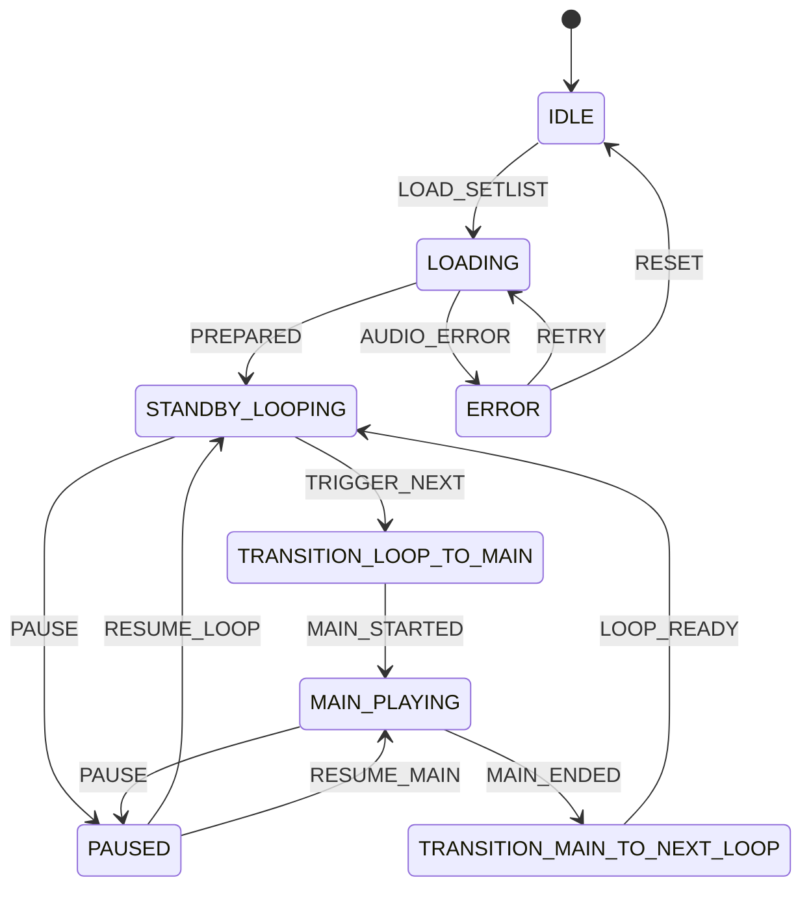

# 00 - Arquitectura y Stack

## Objetivo
Definir la base técnica para una app Android de pistas de acompañamiento para actuaciones en vivo, offline-first, construida con React Native + Expo, enfocada en transiciones de audio en tiempo real confiables para un baterista en escena.

## Alcance
- Estructura del proyecto y límites de módulos.
- Candidatos de librerías exactos y criterios de selección.
- Estrategia de prebuild/nativo de Expo.
- Diseño de la máquina de estados de audio (doble deck + loop intermedio).
- Estrategia de descarga prep-time desde URLs (Google Drive, Mega, etc.) hacia almacenamiento offline.
- Restricciones no funcionales: offline, disparo de baja latencia, fiabilidad de pantalla/batería.

## Entregables
- [ ] Documento de arquitectura aprobado por el responsable de producto/técnica.
- [x] Decisión final del stack registrada (motor de audio, BD, almacenamiento, navegación, estado, descarga prep-time).
- [x] Diagrama/especificación de la máquina de estados documentado y revisado.
- [x] Registro de riesgos con mitigaciones para el comportamiento de audio/segundo plano en Android.

## Estructura de Carpetas Propuesta
```text
backtracker/
  app/                          # Pantallas de Expo Router (si se usa Expo Router)
  src/
    app/                        # Arranque de la app, providers, navegación
    features/
      setlists/
        components/
        hooks/
        screens/
        services/
      live/
        components/
        hooks/
        screens/
        state-machine/
      audio/
        engine/                 # Adaptadores de reproductor, orquestación de decks
        fades/                  # Controladores de fade/crossfade
        hooks/
        types/
      library/
        import/
        storage/
    data/
      db/
        schema/
        migrations/
        repositories/
      models/
    services/
      filesystem/
      permissions/
      wake-lock/
      diagnostics/
    shared/
      components/
      hooks/
      constants/
      utils/
      theme/
    types/
  assets/
  docs/
  TODO/
  app.config.ts
  package.json
```

## Stack Recomendado (Librerías Exactas a Validar)

| Área | Recomendado | Propósito | Notas / Aceptación |
|---|---|---|---|
| Runtime | Expo SDK (última versión estable al momento de implementar) + React Native | Base de la app móvil | Usar Development Build / prebuild; Expo Go no es suficiente para el comportamiento nativo de audio/segundo plano requerido. |
| Lenguaje | TypeScript (`strict: true`) | Seguridad de tipos | No usar `any` en los módulos centrales de audio/estado salvo justificación. |
| Motor de audio | `react-native-track-player` | Reproducción en segundo plano, cola/eventos, integración con el servicio en primer plano de Android | Candidato principal para el control de reproducción en vivo y hooks de eventos. Validar el loop gapless y la estrategia de fade en dispositivos Android reales. |
| Audio alternativo | `expo-audio` / enfoque basado en ExoPlayer | Integración más simple con Expo | Evaluar solo si Track Player no puede cumplir los requisitos de gapless/fade/control. Documentar los compromisos antes de elegir. |
| BD local | `expo-sqlite` | Metadatos locales estructurados (setlists, canciones, asignaciones) | Preferido para consultas relacionales y ordenamiento. |
| Alternativa clave-valor | `react-native-mmkv` | Ajustes/caché rápidos | Opcional para ajustes pequeños de la app; no es un reemplazo de los datos relacionales de setlists. |
| Almacenamiento de archivos | `expo-file-system` | Copiar/importar audio en el sandbox de la app | Almacenar URIs internas canónicas de archivos; no depender nunca de URIs externas temporales. |
| Selección/importación de archivos | `expo-document-picker` (y/o `react-native-document-picker` si es necesario) | Seleccionar WAV/OGG/FLAC del dispositivo | Validar el manejo de URIs SAF de Android y el acceso persistente/comportamiento de copia. |
| Descarga prep-time | `expo-file-system` con `createDownloadResumable`; `react-native-blob-util` / `RNFetchBlob` si se requiere para Mega/Google Drive | Descargar audios o carpetas/playlist desde una URL hacia el almacenamiento interno | Solo en fase de preparación. El playback en vivo es 100% offline y no requiere red. Validar reanudación, enlaces con autenticación y carpetas completas. |
| Mantener despierto | `expo-keep-awake` | Evitar que la pantalla se apague durante el modo vivo | Usar solo en la pantalla de modo vivo; proveer salida explícita. |
| Navegación | `@react-navigation/native` + native stack/bottom tabs | Flujos de Admin + Modo Vivo | Mantener el modo vivo aislado para reducir navegación accidental. |
| Manejo de estado | Zustand o Redux Toolkit (elegir uno) | Estado predecible de la app/UI de audio | El motor de audio sigue siendo la fuente de verdad para los eventos de reproducción; el estado de UI lo refleja. |
| Validación | Zod | Validación en runtime para importaciones/config | Validar filas de BD/metadatos de importación donde sea útil. |
| Pruebas | Jest + React Native Testing Library; Detox/Maestro para E2E (evaluar) | Unitarias/integración/E2E | Las transiciones de audio requieren validación manual/E2E a nivel de dispositivo. |

## Estrategia de Descarga Prep-Time (URLs)
- [x] La descarga de audios es una operación de PREPARACIÓN: el usuario obtiene los archivos antes de la actuación; la reproducción en vivo no requiere red.
- [x] Soportar descarga de uno o varios audios desde URL (Google Drive, Mega y enlaces directos admitidos por la librería elegida).
- [x] Soportar carpetas/playlist completas cuando el proveedor lo permita (recorrido de enlaces o empaquetado por el usuario).
- [x] Descargar a almacenamiento gestionado por la app y persistir la URI interna; registrar la URL de origen solo como metadato informativo.
- [x] Usar `expo-file-system` + `createDownloadResumable` como primera opción; evaluar `react-native-blob-util` / `RNFetchBlob` solo si se necesitan capacidades que la primera no cubre (Mega/Google Drive, cabeceras, etc.).
- [x] Implementar reanudación de descargas interrumpidas y limpieza de descargas parciales.
- [x] Validar espacio en disco antes y durante la descarga; reanudar el flujo de importación sin corromper `audio_assets`.

## Estrategia de Prebuild / Nativo de Expo
- [x] Usar **Expo Managed workflow con CNG + Development Builds** (`npx expo prebuild` cuando se requiera configuración/plugins nativos).
- [x] No depender de Expo Go para la validación final de audio/segundo plano.
- [x] Rastrear toda la configuración nativa en `app.config.ts` / `app.json` y config plugins; evitar ediciones manuales en las carpetas nativas generadas salvo que sea inevitable y documentado.
- [x] Si se requieren ediciones manuales nativas, documentarlas en `docs/native-changes.md` y considerar un config plugin.
- [x] Definir perfiles de EAS: `development`, `preview`, `production`.
- [ ] Fijar versiones del SDK y de librerías críticas de audio después de la validación.

## Diseño de la Máquina de Estados de Audio (Doble Canal / Dos Decks)

### Modelo Conceptual
Dos decks lógicos:
- **Deck A - Pista principal:** Reproduce la pista de la canción actual una vez (o según configuración). La fuente puede estar en estéreo/panned (click/guía L, secuencia R).
- **Deck B - Loop intermedio:** Reproduce ambiente/pad/loop en forma continua con loop gapless habilitado.

Un único orquestador/máquina de estados coordina ambos decks para evitar comandos conflictivos.

### Estados
- `IDLE`: No hay setlist cargada / no hay audio preparado.
- `LOADING`: Resolviendo assets, preparando buffers/reproductores.
- `STANDBY_LOOPING`: Loop intermedio reproduciéndose; esperando la acción del baterista.
- `TRANSITION_LOOP_TO_MAIN`: Fade out del loop, inicio de la pista principal.
- `MAIN_PLAYING`: Pista principal reproduciéndose; loop detenido o silencioso.
- `TRANSITION_MAIN_TO_NEXT_LOOP`: Pista principal finalizó; fade in del siguiente loop intermedio.
- `PAUSED`: Pausa manual (si la UX lo permite). Definir comportamiento exacto.
- `ERROR`: Error de audio o de archivo recuperable/no recuperable.

### Eventos
- `LOAD_SETLIST`
- `PREPARE_NEXT`
- `TRIGGER_NEXT` (manual, botón grande/gesto)
- `MAIN_ENDED` (evento del reproductor)
- `AUDIO_ERROR`
- `APP_BACKGROUND` / `APP_FOREGROUND`
- `STOP_SHOW`

### Reglas de Transición
- [x] `STANDBY_LOOPING + TRIGGER_NEXT` -> fade out del Deck B durante la duración configurada (ej., 300-800ms), iniciar el Deck A en T0 con latencia mínima.
- [x] `MAIN_PLAYING + MAIN_ENDED` -> resolver el sonido intermedio de la siguiente canción (específico de la canción > predeterminado de la setlist/global > silencio), hacer fade in del Deck B y loop gapless.
- [x] Si el siguiente intermedio es `SILENCE`, permanecer en un estado de espera silenciosa con indicador visual.
- [x] `TRIGGER_NEXT` debe ser idempotente/bloqueado durante la transición para evitar doble disparo.
- [x] Todas las transiciones emiten logs/eventos estructurados para depuración.

### Diagrama de la Máquina de Estados (Mermaid)


## Decisiones Técnicas Clave a Registrar
- [x] Elección final del motor de audio y justificación.
- [x] Método de loop gapless (loop nativo, configuración de ExoPlayer o assets preprocesados).
- [x] Implementación de fade (temporizador JS/rampa de volumen vs procesamiento de audio nativo) e impacto en latencia.
- [x] Fuente de verdad de eventos (callbacks/eventos del reproductor) y estrategia de debounce/bloqueo.
- [x] Política de formatos de archivo: formatos de importación preferidos, estrategia de normalización opcional.
- [x] Estrategia de descarga prep-time: librería, reanudación, espacio en disco y manejo de enlaces con autenticación o que expiran.

## Riesgos y Mitigaciones
| Riesgo | Impacto | Mitigación |
|---|---|---|
| El loop gapless no es verdaderamente continuo en el motor elegido | Click audible durante la actuación en vivo | Validar pronto en dispositivos Android físicos; preparar motor de respaldo o assets de loop continuo preprocesados. |
| Interrupciones por segundo plano/foco de audio | La reproducción se detiene a mitad de la actuación | Implementar servicio en primer plano/manejo del foco de audio; probar llamadas, notificaciones, desconexiones de BT. |
| Las pausas del hilo JS causan fade/disparo tardío | Transiciones tardías | Mantener mínimos los comandos de audio; evitar trabajo pesado de UI durante transiciones; perfilar rendimiento. |
| Las URIs de archivos externos se vuelven inaccesibles | Falta de audio en la actuación | Copiar/importar al almacenamiento gestionado por la app y persistir rutas internas. |
| Las optimizaciones de batería matan la app | Fallo de la actuación | Usar wake lock/reproducción en primer plano; documentar los ajustes de batería específicos del fabricante (OEM) para los usuarios. |
| Enlaces de descarga que expiran o requieren autenticación | No se puede completar la descarga prep-time | Descargar antes de la actuación, verificar el enlace y persistir los archivos localmente; no depender del enlace en vivo. |
| Descarga de carpetas/playlist incompleta | Faltan pistas o loops en la actuación | Descargar carpetas completas con reanudación y verificaciones por archivo; validar integridad antes de dar por finalizada la preparación. |
| Espacio en disco insuficiente durante la descarga | Importación fallida o archivos corruptos | Verificar espacio disponible antes de descargar y limpiar descargas parciales. |
| Descargas interrumpidas sin reanudación | Retrabajo y ancho de banda desperdiciado | Usar descargas reanudables (`createDownloadResumable` o equivalente) y conservar el estado de la descarga. |

## Criterios de Aceptación
- [x] Un desarrollador puede leer este documento y entender los límites del sistema, el stack y el flujo de audio.
- [x] El stack elegido incluye nombres exactos de paquetes y criterios claros de validación.
- [x] La máquina de estados cubre espera, disparo, reproducción principal, retorno automático al loop, errores y bloqueos.
- [x] La estrategia de prebuild/nativo evita explícitamente suposiciones de Expo Go.
- [x] La estrategia de descarga prep-time deja claro que el playback no requiere red.
- [x] Los riesgos incluyen mitigaciones concretas y requisitos de validación en dispositivo.
