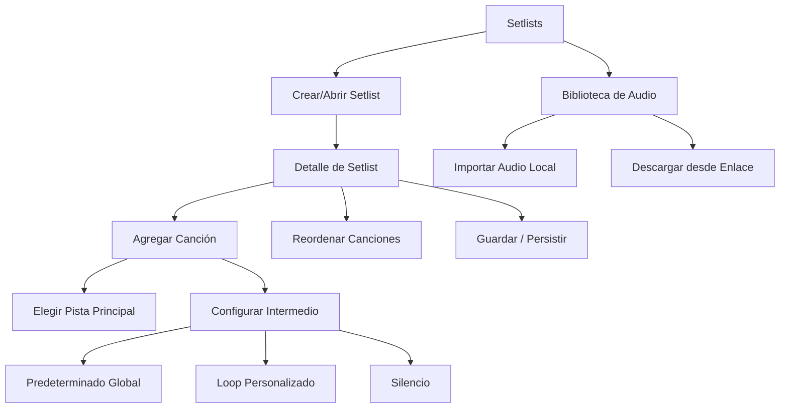

# 04 - UI: Gestión de Setlists

## Objetivo
Construir la UI de administración para preparar actuaciones: gestionar setlists, importar audio local, descargar audio desde enlaces, asignar pistas principales y loops intermedios, y configurar el comportamiento de transición global/por canción.

## Dependencias
- Navegación y UI base de `01-setup-e-infraestructura.md` listas.
- Repositorios/servicios de `02-modelo-datos-y-almacenamiento.md` disponibles.
- Hooks de preview/reproducción de audio de `03-motor-audio-y-gapless-loop.md` disponibles (opcional pero útil).

## Entregables
- [x] Pantallas de lista/creación/edición/eliminación de setlists.
- [x] Ordenamiento de canciones y UI de configuración por canción.
- [x] UI de importación de audio, descarga desde enlace y selección de biblioteca.
- [x] Configuración global y por canción del loop intermedio.
- [x] Validación y estados vacíos/de error.

## Tareas

### 1. Arquitectura de Información / Pantallas
- [x] **Pantalla de Setlists:** listar todas las setlists, crear nueva, duplicar, eliminar, abrir.
- [x] **Pantalla de Detalle de Setlist:** canciones ordenadas, agregar canción, reordenar, editar, eliminar.
- [x] **Editor de Canción / Hoja:** título de la canción, selección de pista principal, modo/configuración intermedia, anulaciones de fade.
- [x] **Pantalla de Biblioteca de Audio:** assets importados, filtrar por tipo (principal/intermedio), acciones de importación y descarga, indicador de archivo faltante.
- [x] **Pantalla de Ajustes:** predeterminado intermedio global, duraciones de fade predeterminadas, opciones de debug.

### 2. CRUD de Setlists
- [x] Crear setlist con nombre y descripción opcional.
- [x] Editar metadatos de la setlist.
- [x] Duplicar setlist incluyendo orden de ítems y referencias de audio.
- [x] Eliminar setlist con confirmación (no eliminar assets de audio compartidos salvo solicitud explícita).
- [x] Mostrar conteo de canciones, duración total estimada (si está disponible) y última actualización.

### 3. Gestión de Canciones/Ítems
- [x] Agregar ítem de canción con pista principal requerida.
- [x] Permitir reordenar mediante drag handle (y controles accesibles de subir/bajar como alternativa).
- [x] Persistir el reordenamiento inmediatamente o al guardar explícitamente; definir y documentar el comportamiento.
- [x] Editar título/notas de la canción.
- [x] Eliminar canción de la setlist con confirmación.
- [x] Prevenir estado inválido: la canción no se puede guardar sin un asset de audio principal válido.

### 4. Importación, Descarga y Selección de Audio
- [x] Agregar acción "Import Audio" desde la Biblioteca de Audio y desde los selectores.
- [x] Agregar acción "Descargar desde enlace" para importar uno o varios audios (y carpetas/playlist cuando el proveedor lo permita) desde Google Drive, Mega o un enlace directo.
- [x] Soportar selección de archivos locales (WAV/OGG/FLAC; otros opcionales según decisión).
- [x] Validar el enlace y el formato del archivo descargado antes de incorporarlo a la biblioteca.
- [x] Mostrar progreso/estado de importación y descarga (incluida la reanudación) y mensajes de error claros (enlace inválido/expirado, error de red, espacio insuficiente, formato no soportado).
- [x] Permitir seleccionar un asset de audio importado/descargado existente para pista principal o loop intermedio.
- [x] Mostrar metadatos: nombre de archivo, duración, formato, tamaño, estado de faltante y origen (local/descarga).
- [x] Proveer preview de reproducción para assets (ruta de motor no en vivo corta y segura o uso controlado del motor).

### 5. Configuración del Loop Intermedio
- [x] Ajuste de predeterminado intermedio global en Ajustes.
- [x] Selector de modo intermedio por canción:
  - [x] `Usar Predeterminado Global`
  - [x] `Intermedio Personalizado`
  - [x] `Silencio`
- [x] Cuando se selecciona `Intermedio Personalizado`, requerir elegir un asset de audio.
- [x] Mostrar resumen de resolución del intermedio efectivo en la fila/editor de la canción.
- [x] Permitir anulación opcional de fade in/out por canción (ms) con límites de validación.
- [x] Advertencia visual cuando el intermedio resuelto está faltante.

### 6. Calidad de UX/UI para Admin (Preparación Pre-Vivo)
- [x] Modo oscuro por defecto, alto contraste, tipografía legible.
- [x] Objetivos táctiles grandes para acciones clave.
- [x] Estilo claro para acciones destructivas y confirmaciones.
- [x] Estados vacíos con guía (sin setlists, sin canciones, sin audio importado).
- [x] Estados de carga/skeleton para consultas de BD, importaciones y descargas.
- [x] Bases de accesibilidad: etiquetas, tamaño de objetivo táctil, orden de foco, contraste.

### 7. Integridad de Datos y Seguridad
- [x] Confirmar antes de eliminar una setlist o quitar una canción.
- [x] Manejar referencias de audio faltantes con acción "Revincular".
- [ ] Prevenir pérdida de navegación por cambios no guardados (diálogo de confirmación). (no aplica: persistencia inmediata en SQLite)
- [x] Asegurar que todas las ediciones persistan localmente y sobrevivan el reinicio de la app.
- [x] Agregar log de auditoría/debug básico para acciones de importación, descarga y asignación (solo dev).

## Flujo de UX (Mermaid)

## Criterios de Aceptación
- [x] El usuario puede crear una setlist, agregar canciones, asignar pistas principales y reordenarlas.
- [x] El usuario puede configurar el loop intermedio predeterminado global.
- [x] El usuario puede anular el intermedio por canción o establecerlo en silencio.
- [x] Los archivos de audio importados o descargados aparecen en la biblioteca y siguen disponibles después del reinicio.
- [x] La descarga desde enlace muestra progreso, errores claros y reanudación.
- [x] Los archivos faltantes se indican claramente y no hacen que la UI se cierre.
- [x] Todas las acciones de gestión son utilizables offline (la descarga requiere red, pero la gestión y reproducción no).
- [x] La UI es legible en modo oscuro/alto contraste y usa tamaños de objetivo táctil seguros.
